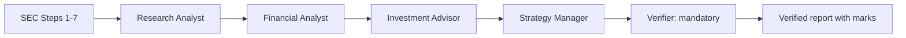

# FIN 67110 — Checkpoint 2: Agent Team + Verifier

**Status: implementation and synthetic source-backed unit tests complete; live API/UI/partner verification still required before submission.**

Official deadline: **Thursday, November 5, 2026 at 11:59 PM Eastern**. Submit an **immutable GitHub commit URL**, not only the repository homepage, in Brightspace → Checkpoint 2. Checkpoint scores are 100 complete / 0 incomplete.

## What this upgrade does

The original `sec_desk.py` is unchanged and remains the seven-step SEC-data pipeline. A new fixed LangGraph runs:



The three analysts plus Manager each receive task, context, and expected output as JSON. They use role instructions in `roles/`. The Manager can send each analyst **one** correction request. The Verifier is always called after the Manager and only receives the compiled `report.md`, saved filing `.txt` files, and saved `facts.json`. There is no skip-verifier switch. A `--verify-only` mode runs just the Verifier against an existing report.

For each run: `runs/COMPANY_TICKER_DATE_TIME_UTC` saves filing texts, SEC facts, ratios, model inputs/outputs in `nodes/`, `report.md`, `verified_report.md`, and `verifier_marks.json`. Folder names use microsecond timestamps; previous runs are left alone.

The Verifier checks **structured numeric evidence** embedded inside the report's `evidence-json` block. It compares XBRL tag, period, accession and value; checks exact filing lines after spacing normalization; and recalculates ratios using sourced quoted inputs. It also flags unregistered monetary/percent statements. **Do not treat this as proof it detects every possible unsourced number:** arbitrary plain numeric prose, materiality judgments and unsupported investor theses still require human review. Filing-line assertions without XBRL support require the model semantic check. If API_KEY is missing, those line-only claims are marked unsupported, not certified.

## Install on Windows PowerShell

Copy this upgrade **into the root of your existing cloned** `FIN-67110-Checkpoint-1` repository. Do not delete `desk.py`, `roles.py`, `sec_desk.py`, earlier runs, or the `.git` folder. From that root:

```powershell
py -m venv .venv
.\.venv\Scripts\python.exe -m pip install -r requirements.txt
Copy-Item .env.example .env -ErrorAction SilentlyContinue
notepad .env
.\.venv\Scripts\python.exe -m pytest -q
```

In your **local `.env` only**, enter `API_KEY`, `SEC_USER_AGENT`, and the model identifier available to your API account (e.g. `MODEL_NAME=gpt-4.1-mini`). Do **not** share the key or commit `.env` to GitHub. The previous repository already warns that the API account lacked credits during Checkpoint 1; you must have live API access/credit to prove three model role Insights and the model review.

The source archive includes the `requirements.txt` with LangGraph and Streamlit added. `langgraph` is loaded for the full graph, not for `--verify-only`. If `py` points to a Python install with incompatible dependencies, use a Python 3.11–3.13 environment for the assignment.

## Run twice on your real Costco data

The instructor requires **the same official pre-release close you used in Lab 03** for September 23, 2026. It was not present in the supplied saved run, so enter your documented value, not a guessed price:

```powershell
$P = Read-Host "Enter the documented Sep 23 2026 COST closing price"
.\.venv\Scripts\python.exe agent_team.py COST --peers WMT,TGT,BJ --price $P --price-date 2026-09-23
.\.venv\Scripts\python.exe agent_team.py COST --peers WMT,TGT,BJ --price $P --price-date 2026-09-23
```

Both runs must print `NODE — Steps 1–7`, `Research Analyst`, `Financial Analyst`, `Investment Advisor`, `Strategy Manager`, `Verifier` in order (a role may show a single labeled retry). Verify that they created **different run folders** and that the first folder was not overwritten.

To replay previously collected data **for debugging only** (not proof of live SEC retrieval):

```powershell
.\.venv\Scripts\python.exe agent_team.py COST --peers WMT,TGT,BJ --source-run "runs\COSTCO_WHOLESALE_CORP_NEW_COST_2026-10-28_075015_UTC" --price $P --price-date 2026-09-23
```

The source-run mode copies the old data to a new folder; it still calls the roles and Verifier. Its report is explicitly marked as a replay.

## Produce real Lab 04 seeded error marks

Use the path of one of the **actual** `runs/*COST*/report.md` folders printed by the completed graph. Set it in PowerShell:

```powershell
$run = "runs\REPLACE_WITH_YOUR_ACTUAL_COMPLETED_COST_RUN_FOLDER"
.\.venv\Scripts\python.exe seed_error.py $run --test eps
.\.venv\Scripts\python.exe seed_error.py $run --test growth
.\.venv\Scripts\python.exe agent_team.py --verify-only $run
```

The scripts copy the report **without touching the original**, seed a $1 higher **diluted EPS** or a **four-percentage-point** higher revenue growth with the cited inputs, then run Verifier on the copy. Open the resulting `SEEDED_EPS.../verified_report.md` and confirm the EPS row says `wrong`, with the genuine EPS and the saved 10-K line. `SEEDED_GROWTH` must show corrected arithmetic. Confirm all eleven clean-report claims correct on the actual audited run, not just the synthetic fixtures. If the live Financial Analyst omitted a structured EPS/growth claim, the seed script will fail honestly and you must repair that role.

The bundled `tests/fixtures/` reports are **synthetic evidence-driven tests**, not live-role reports. They demonstrate 11/11 clean, incorrect $21.76 EPS versus actual $20.76, and incorrect 14.14% growth versus 10.14%. **Do not submit these as if they were the live Lab 04 run.**

## Lab 05 — your own responsibilities

**Write the three analyst personas yourself** in `roles/research_analyst.md`, `roles/financial_analyst.md`, and `roles/investment_advisor.md`. The files currently contain the previous baseline instructions and technical evidence rules, not student-authored personas. The course specifically prohibits AI from writing the persona. Replace the inherited baseline text in **your own words**, using all six parts: (1) Identity, (2) Reading approach, (3) Given evidence, (4) Scored criteria with numeric sourced examples, (5) What would change your view, (6) Output and a sourced `Insight:` line. Keep source syntax and required JSON keys intact. Do not name a company in role instructions.

The Manager (`roles/strategy_manager.md`) retains the five-part checklist and checks each analyst's `Insight:` against the release's first paragraph. A missing/uncited/repeated Insight triggers one bounded retry. Rerun Costco; inspect **three Insight lines**, each with a source and a verifier mark. The model-generated report may need manual prompt adjustment; this environment has not run a live API call.

Ask your partner for a ticker of a US company that reported during the required month; choose appropriate peers. Run its agent team using a fresh filing set. Have your partner manually verify **two core claims** in the filings and write the marks **at the top of the partner report**. Then the partner must run the UI without opening a terminal:

```powershell
.\.venv\Scripts\python.exe -m streamlit run app.py
```

Finally form a three-person team, agree on a team name, and show the roster to the instructor. These are class activities; the generated files cannot authenticate that they happened.

## GitHub and Brightspace

Once the actual Costco seeded report and partner-run evidence are saved, copy the necessary output folders into your cloned repository, verify `.env` is ignored, then:

```powershell
git status
git add agent_team.py verifier.py seed_error.py app.py roles requirements.txt tests CHECKPOINT2_README.md CHECKPOINT2_STATUS.md PERSONAS_TO_WRITE.md
# Add the two real run folders and marks deliberately, without .env or secret files:
git add runs
# Inspect changes and secrets before commit:
git diff --cached --stat
git commit -m "Checkpoint 2: fixed graph, required verifier, seeded EPS test, personas and UI"
git push origin main
git rev-parse HEAD
```

Submit this type of link (with the **new** SHA from your actual push) in Brightspace:

`https://github.com/anshdoshi14/FIN-67110-Checkpoint-1/commit/ACTUAL_FULL_COMMIT_SHA`

The repository URL alone is not the requested immutable permalink. Do not submit the placeholder SHA or claim the tests ran on your machine until you checked them.

## Questions your instructor may ask

- **Who decides the next node?** Code and LangGraph's fixed edges; the model makes analytic judgments inside its assigned node.
- **Which workflow matches the Manager?** Orchestrator/worker coordination, now constrained to a fixed graph and one retry. **Which matches the Verifier?** Evaluator/optimizer; it independently evaluates compiled report claims against saved evidence.
- **What the Verifier sees:** compiled report, saved filing text and saved XBRL facts. **What it never sees:** research and advisor instruction files, model private reasoning, or roles' draft prompts.
- **Why hide prompts from the Verifier?** It reduces correlated errors and encourages evidence-only review rather than repeating the producer's assumption.
- **One blind spot:** it cannot decide whether a factually true claim answers the client's question. Also, the Investment Advisor's subjective thesis is deliberately outside numeric verification.

**Reference:** official [Week 3](https://cinderzhang.github.io/FIN67110-Fall2026/week-03/index.html), [Lab 04 and Lab 05 linked from Week 3](https://cinderzhang.github.io/FIN67110-Fall2026/week-03/index.html), [grading](https://cinderzhang.github.io/FIN67110-Fall2026/grading.html), and [schedule](https://cinderzhang.github.io/FIN67110-Fall2026/schedule.html).
