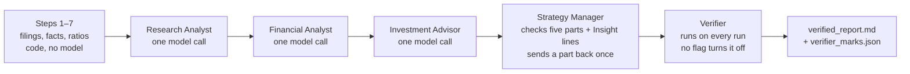

# FIN 67110 — SEC Research Desk as an Agent Team (Checkpoint 2)

A four-role equity-research desk whose process is a fixed graph in code, with a Verifier node that no run can skip. Checkpoint 1 (the seven SEC data steps and the first four-role desk) is preserved underneath; its documents are in `docs/`.

## The graph

Same nodes, same order, on every run. A model never decides which node runs next.



| Code decides | The model decides |
|---|---|
| Which node runs next, and when the run stops (`agent_team.py`, LangGraph edges) | What the business is and where it stands |
| What each node is shown, as JSON: task, context, expected output (`nodes/*_input.json`) | Which development is the catalyst |
| A missing or headline-only part goes back to its role once, never twice | The thesis, and the one number that decides it |
| The Verifier runs after the Manager, every time | Whether a cited line states that number, for that period, in that definition |
| What is saved, and where (`runs/COMPANY_TICKER_DATE_TIME_UTC/`) | The one Insight the headline does not state |

Two things the Verifier cannot catch by design: a true line cited for the wrong claim (the audit's "Missing" mark is human judgment), and the Investment Advisor's thesis, which no filing can confirm.

## Install

Windows PowerShell, from the repository root:

```powershell
py -m venv .venv
.\.venv\Scripts\python.exe -m pip install -r requirements.txt
Copy-Item .env.example .env
notepad .env            # set API_KEY, SEC_USER_AGENT, MODEL_NAME; never commit .env
.\.venv\Scripts\python.exe -m pytest -q
```

macOS / Linux: replace `.\.venv\Scripts\python.exe` with `.venv/bin/python` and `py` with `python3`.

## Run

```powershell
# the agent team on a ticker, with peers and the pre-release closing price
.\.venv\Scripts\python.exe agent_team.py COST --peers WMT,TGT,BJ --price 904.70 --price-date 2026-09-23

# verify a saved run (runs the Verifier and nothing else)
.\.venv\Scripts\python.exe agent_team.py --verify-only runs\COSTCO_WHOLESALE_CORP_NEW_COST_2026-11-05_081340_UTC

# seed the two Lab 04 known-answer tests into a COPY of a saved run, then verify the copy
.\.venv\Scripts\python.exe seed_error.py runs\COSTCO_WHOLESALE_CORP_NEW_COST_2026-11-05_081340_UTC --test eps
.\.venv\Scripts\python.exe seed_error.py runs\COSTCO_WHOLESALE_CORP_NEW_COST_2026-11-05_081340_UTC --test growth

# the page (no terminal needed by the person using it)
.\.venv\Scripts\python.exe -m streamlit run app.py
```

Each run prints the node names in graph order and ends with `FINAL — <path to verified_report.md>`. Every run gets its own folder; earlier runs are never overwritten. Nothing in the code names a company.

## Evidence index (what is in `runs/`)

| Folder | What it proves |
|---|---|
| `COSTCO_..._2026-11-05_081340_UTC` | Live full graph on COST (peers WMT, TGT, BJ; price $904.70 on 2026-09-23). Base for the two seeded tests. |
| `..._081340_UTC_SEEDED_EPS_20261105_103900_754262` | **Checkpoint 2 known answer.** Diluted EPS seeded to $21.76 with its source line changed. Verifier row: `diluted_eps_current \| 21.76 \| wrong \| 20.76 — 10-K 0000909832-26-000093, EarningsPerShareDiluted, 2026-08-30; 10-K L1057`. Original run untouched (`seed_manifest.json`). |
| `..._081340_UTC_SEEDED_GROWTH_20261105_104648_825055` | Invented number: revenue growth seeded to 14.14% with the two 10-K revenues quoted. Verifier row: `revenue_growth \| 0.1414 \| wrong \| 10.14% — (a − b)/b from a=303,154 b=275,235`. |
| `COSTCO_..._2026-11-05_104149_363370_UTC` | Second live graph on COST: same node order, new folder, first run untouched. |
| `COSTCO_..._2026-11-05_183409_583754_UTC` | Persona-based COST run: three `Insight:` lines, one per analyst, each with a verifier mark. |
| `COSTCO_..._2026-11-05_184645_068555_UTC` | Persona-based COST run with stricter SEC-frame matching; three Insight lines. |
| `Apple_Inc_AAPL_2026-11-05_075253_UTC` | Partner's pick (Zainab Fashola chose AAPL; peers MSFT, GOOGL, ORCL; price $344.63 on 2026-10-30). Data run referenced by `audits/APPLE_team_manual_review.md`. |
| `Apple_Inc_AAPL_2026-11-05_183135_891654_UTC` | Persona-based Apple report: five parts, three Insight lines, verifier table. |
| `COSTCO_..._2026-10-28_075015_UTC`, `Walmart_..._2026-10-28_075118_UTC`, `PEPSICO_..._2026-10-29_014807_UTC` | Checkpoint 1 data runs and the PEP partner fallback report. |

`tests/fixtures/` holds synthetic, SEC-backed fixtures used only by `pytest` (11/11 clean, $21.76 EPS, 14.14% growth). They are not live-run evidence and are not presented as such.

## Repository layout

```
agent_team.py      fixed LangGraph: Steps → RA → FA → IA → Manager → Verifier; --verify-only
verifier.py        independent checker: XBRL exact match, line presence, ratio recompute, model semantic check
seed_error.py      copies a run and seeds the $1 EPS or +4pt growth error for the known-answer tests
app.py             Streamlit page over agent_team.py
sec_desk.py        the seven SEC data steps (Checkpoint 1, unchanged)
desk.py, roles.py  Checkpoint 1 desk and role caller (kept for history)
roles/             four role files; the three analyst personas are student-authored, company-neutral
audits/            COST_audit.md, APPLE_team_manual_review.md, PEP_audit.md, partner template
runs/              saved evidence (see index above)
tests/             40 pytest tests incl. the seeded-error, clean-report and too-eager guards
docs/              Checkpoint 1 README, status and checklist (history)
CHECKPOINT2_STATUS.md   what is done, what is still manual
SUBMISSION.md           the text to paste into Brightspace once the commit exists
```

## Verifier rules (short form)

- XBRL-sourced number: tag + period end + accession must exist in `facts.json`; value compared exactly.
- Line-sourced number: the cited line must exist in the saved filing text and must contain the number (whole-token match, allowing `$`, commas, `%` and millions/billions formatting). A paraphrased quotation is not an error if the number is on the line; the model then decides period and definition. A line that does not contain the number is **wrong**.
- Ratio: recomputed from its quoted inputs, each of which must itself resolve to an XBRL fact.
- No source, or a ratio with no definition where the filing offers two (average vs year-end equity): **unsupported**.
- The Investment Advisor's thesis is skipped. Prose figures without a `[C:id]` are listed as unsupported.

This is a learning exercise, not financial advice.

AI assistance: ChatGPT assisted with the Checkpoint 1 code and documentation; Claude assisted with the Checkpoint 2 verifier bug fix, repository clean-up and documentation. All audit marks and the personas are the students' own responsibility.

Any remaining errors are my own.
