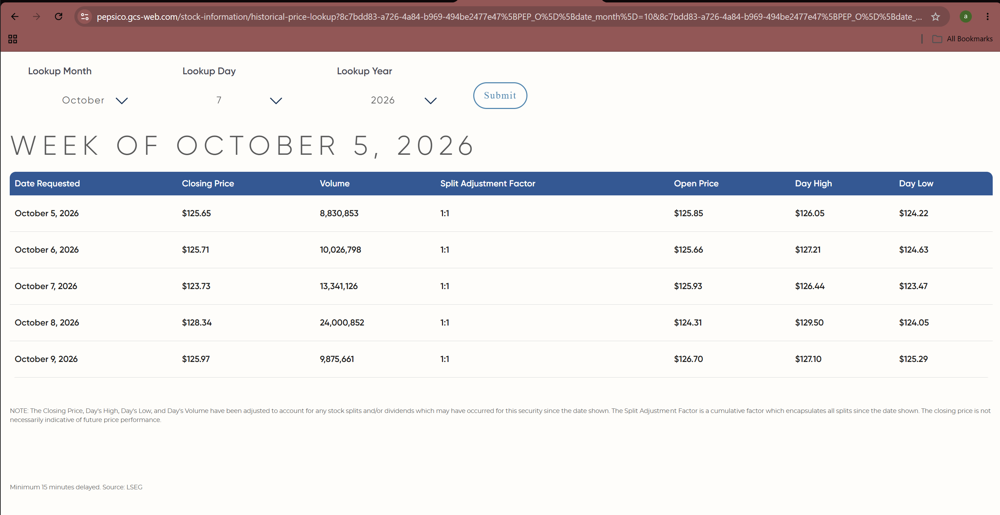

# PepsiCo (PEP) historical price evidence — October 7, 2026

- **Lookup:** PepsiCo Investor Relations, [Historical Price Lookup](https://pepsico.gcs-web.com/stock-information/historical-price-lookup)
- **Provider shown on lookup:** LSEG
- **Requested date:** October 7, 2026
- **Closing price shown:** $123.73
- **Volume shown:** 13,341,126
- **Split adjustment factor shown:** 1:1
- **Open / high / low shown:** $125.93 / $126.44 / $123.47
- **Screenshot reviewed:** student-provided browser screenshot, November 2, 2026
- **Evidence form in this repository:** original screenshot and a transcription of the displayed lookup row.

The lookup page states that closing price, high, low, and volume are adjusted for stock splits and/or dividends since the date shown. It also states “Minimum 15 minutes delayed. Source: LSEG.” The October 7 close in this row matches the $123.73 figure used in the report. P/E is $123.73 / $6.00 FY 2025 diluted EPS = 20.6217x (20.62x rounded).

The screenshot is archived in this run folder as `PEP_LSEG_price_2026-10-07.png`.
